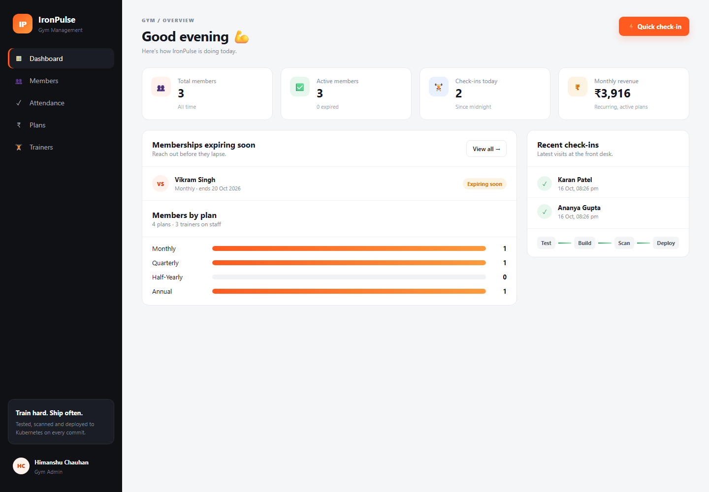

# IronPulse — Gym Management Platform (DevOps Capstone)


IronPulse is a gym management web app: front-desk staff register **members**, sell **membership plans**, assign **trainers** and record **attendance check-ins**. A dashboard shows active and expiring memberships, today's visits and monthly recurring revenue.

The application is the vehicle; the capstone is the delivery pipeline around it. Every push to `main` is tested, built into containers, scanned for vulnerabilities and published to GitHub Container Registry. A Helm chart deploys the stack to Kubernetes with an Ingress, autoscaling and Prometheus/Grafana monitoring. Terraform code describes the AWS VPC + EKS infrastructure for a cloud deployment.



---

## Project status

| Layer | Status |
|-------|--------|
| Application (React + FastAPI + PostgreSQL) | ✅ Built and running via Docker Compose |
| Tests | ✅ 27 pytest tests, all passing |
| Docker | ✅ Multi-stage, non-root images for backend and frontend |
| CI pipeline | ✅ Green on `main`: test → build → Trivy scan → push to GHCR |
| Container registry | ✅ Public images on GHCR, tagged with the commit SHA |
| Security scan | ✅ Both images: 0 fixable HIGH/CRITICAL CVEs |
| Kubernetes + Helm | ✅ Verified on a local cluster (kind): all pods Running, Ingress routing `/` and `/api`, HPA scaled the backend 2 → 6 pods under load |
| Prometheus + Grafana | ✅ Verified locally: backend targets UP, IronPulse dashboard auto-loaded with live data |
| Terraform (AWS VPC + EKS) | 📄 Code included and passes `terraform validate`; **not provisioned** in this submission |
| CI deploy to EKS | 📄 Job included but switched off (runs only when `DEPLOY_ENABLED=true`); shows as *skipped* |

The AWS pieces (`terraform/`, `k8s/storageclass-gp3.yaml`, `helm/ironpulse/values-prod.yaml`, the `deploy` job) are complete and documented below. They were not applied, so no AWS resources or costs exist for this project.

---

## Architecture

```text
Developer ──► GitHub ──► GitHub Actions
                           ├─ pytest (27 tests, isolated SQLite DB)
                           ├─ React production build
                           ├─ docker build (backend + frontend, tag = commit SHA)
                           ├─ Trivy scan (fail on fixable HIGH/CRITICAL)
                           ├─ push to ghcr.io (public)
                           └─ helm upgrade --install   (disabled: needs an EKS cluster)

Kubernetes (local kind / Docker Desktop, or EKS from terraform/)
  Traefik Ingress ── /                    ──► frontend (React + Nginx)  ×2   HPA 2–4
                  ── /api, /docs           ──► backend  (FastAPI)       ×2   HPA 2–6 (2–8 on EKS)
                                                      │
                                                      ▼
                                         PostgreSQL StatefulSet + PVC
  Prometheus ◄── ServiceMonitor (/metrics every 15 s) ── backend pods
  Grafana    ◄── "IronPulse — API Overview" dashboard (auto-provisioned)

Terraform (not applied): AWS VPC (2 public + 2 private subnets, NAT) ──► EKS + managed node group
```

---

## Features

| Area | What it does |
|------|--------------|
| **Members** | Register, edit, search, filter by state (active / expiring soon / expired / frozen), renew, delete |
| **Plans** | Create and price plans (duration in months); a plan in use can't be deleted |
| **Trainers** | Manage coaching staff and see how many members each one trains |
| **Attendance** | One-click check-in; frozen, cancelled or expired members are refused |
| **Dashboard** | KPIs, memberships expiring in the next 7 days, members per plan, recent check-ins |

Membership end dates are computed from the plan duration (Jan 31 + 1 month = Feb 28). The "expired" and "expiring soon" states are derived from the end date rather than stored, so they are never stale. Four plans (Monthly, Quarterly, Half-Yearly, Annual) and three trainers are seeded by a migration.

| Membership plans | Members on mobile |
|---|---|
|  |  |

## Tech stack

| Layer | Tools |
|-------|-------|
| Frontend | React 19, Vite 8, plain CSS (responsive: sidebar → bottom tab bar on mobile) |
| Backend | Python 3.12, FastAPI, SQLAlchemy 2, Pydantic 2, Alembic migrations |
| Database | PostgreSQL 16 |
| Testing | Pytest + FastAPI TestClient on an in-memory SQLite database |
| Containers | Docker multi-stage builds, non-root users, Docker Compose |
| CI/CD | GitHub Actions → GHCR, image tag = Git commit SHA |
| Security | Trivy image scanning (action pinned by commit SHA), restricted Pod Security |
| Kubernetes | Helm chart, Traefik Ingress, HPA, metrics-server |
| Observability | kube-prometheus-stack (Prometheus Operator + Grafana), ServiceMonitor, alert rules |
| Infrastructure as Code | Terraform: AWS VPC + EKS + managed node group + EBS CSI driver |

## Repository layout

```text
.
├── backend/                 FastAPI app
│   ├── app/                 models, schemas, business rules (services.py), routers/
│   ├── alembic/versions/    0001 schema, 0002 seed plans + trainers
│   ├── tests/               pytest suite (conftest.py = isolated test DB)
│   └── Dockerfile           multi-stage, non-root (uid 10001)
├── frontend/                React app
│   ├── src/pages/           Dashboard, Members, Attendance, Plans, Trainers
│   ├── nginx.conf.template  SPA + /api reverse proxy
│   └── Dockerfile           Node build stage → unprivileged Nginx (uid 101)
├── docker-compose.yml       postgres + backend + frontend
├── .github/workflows/       ci-cd.yml (test → build/scan/push → deploy)
├── helm/ironpulse/          chart: deployments, services, ingress, HPA, ServiceMonitor, Grafana dashboard
├── k8s/                     namespace (restricted Pod Security), gp3 StorageClass (EKS)
├── monitoring/              kube-prometheus-stack values, PrometheusRule alerts
├── scripts/                 bootstrap-cluster.sh, load-test.sh, seed-demo-data.sh
├── troubleshooting/         three deliberately broken manifests + lab guide
├── terraform/               AWS VPC + EKS (+ terraform.tfvars.example) — not applied
└── docs/                    rubric evidence map, demo script, app screenshots
```

---

## API

Interactive docs: `http://localhost:8000/docs` with Docker Compose, `http://<ingress>/docs` on Kubernetes.

| Method | Path | Purpose |
|--------|------|---------|
| GET | `/health` | Liveness: process is up (no DB call) |
| GET | `/ready` | Readiness: DB reachable and schema migrated |
| GET | `/metrics` | Prometheus metrics (HTTP + `gym_checkins_total`) |
| GET / POST | `/api/plans` | List / create plans |
| GET / PUT / DELETE | `/api/plans/{id}` | Read / update / delete a plan (409 if in use) |
| GET / POST | `/api/trainers` | List (with member counts) / create trainers |
| GET / PUT / DELETE | `/api/trainers/{id}` | Read / update / delete (members get unassigned) |
| GET / POST | `/api/members` | List (`?state=`, `?q=` search) / register a member |
| GET / PUT / DELETE | `/api/members/{id}` | Read / update (status, plan, trainer…) / delete |
| POST | `/api/members/{id}/renew` | Extend by one plan period |
| GET / POST | `/api/checkins` | Visit log (`?member_id=`, `?limit=`) / check a member in |
| GET | `/api/dashboard/stats` | Dashboard KPIs and plan breakdown |

Example:

```bash
curl -X POST http://localhost:3000/api/members -H 'Content-Type: application/json' \
  -d '{"full_name":"Ananya Gupta","email":"ananya@example.com","plan_id":2,"trainer_id":1}'
curl -X POST http://localhost:3000/api/checkins -H 'Content-Type: application/json' -d '{"member_id":1}'
curl http://localhost:3000/api/dashboard/stats
```

---

## Run locally

**Prerequisites:** Docker Desktop. For the non-Docker path you also need Python 3.12+ and Node 22+.

### Option A: Docker Compose (whole stack, one command)

```bash
docker compose up --build
```

| URL | What |
|-----|------|
| http://localhost:3000 | IronPulse app |
| http://localhost:8000/docs | Swagger UI |
| http://localhost:8000/metrics | Prometheus metrics |

The backend runs `alembic upgrade head` on start, so the tables and seed data appear automatically. To add demo members and check-ins, run `URL=http://localhost:3000 ./scripts/seed-demo-data.sh`.
Stop with `docker compose down`; add `-v` to also delete the database volume.

### Option B: run the services directly

```bash
# Backend (needs a PostgreSQL; `docker compose up -d postgres` is the quickest)
cd backend
python -m venv .venv && source .venv/bin/activate      # Windows: .venv\Scripts\activate
pip install -r requirements-dev.txt
cp .env.example .env
alembic upgrade head
uvicorn app.main:app --reload --port 8000

# Frontend (separate terminal; Vite proxies /api to :8000)
cd frontend
npm ci
npm run dev                                            # http://localhost:5173
```

## Tests

```bash
cd backend
pytest -v
```

27 tests cover health, readiness and metrics; CRUD for plans, trainers and members; validation errors and duplicate detection; membership expiry, freezing and renewal; check-in rules; and dashboard statistics.

`tests/conftest.py` overrides FastAPI's `get_db` dependency with a fresh in-memory SQLite database for every test (foreign keys enabled), so tests never touch PostgreSQL. CI runs them before any image is built: if a test fails, nothing is pushed.

---

## CI/CD pipeline

[`.github/workflows/ci-cd.yml`](.github/workflows/ci-cd.yml) runs on every push and pull request to `main`:

| Job | Steps |
|-----|-------|
| **test** | `pip install -r requirements-dev.txt` → `pytest -v` → `npm ci` → `npm run build` |
| **build-scan-push** (needs test) | build both images tagged with `${{ github.sha }}` → Trivy scan each (fail on fixable HIGH/CRITICAL) → log in to GHCR → push (skipped for pull requests) |
| **deploy** (needs build) | `aws eks update-kubeconfig` → `helm upgrade --install --wait` with the new SHA. **Disabled in this project**: it shows as *skipped* because no EKS cluster exists. |

Using the commit SHA as the image tag gives traceability: any running pod can be traced to the exact commit that produced it, and `helm rollback` returns to a known image. A mutable `latest` tag can't do either.

<details>
<summary>How to enable the deploy job (only if an EKS cluster is created)</summary>

| Setting | Kind | Value |
|---------|------|-------|
| `DEPLOY_ENABLED` | Repository variable | `true` |
| `AWS_REGION`, `EKS_CLUSTER_NAME` | Variables (optional) | default `ap-south-1`, `ironpulse-eks` |
| `AWS_ACCESS_KEY_ID`, `AWS_SECRET_ACCESS_KEY` | Secrets | IAM user allowed to deploy to the cluster |
| `POSTGRES_PASSWORD` | Secret (optional) | database password for the cluster |

</details>

## Published images

Both images are **public** on GitHub Container Registry, so they can be pulled without logging in:

| Image | Package |
|-------|---------|
| `ghcr.io/himanshu10071/ironpulse-backend` | [ironpulse-backend](https://github.com/users/Himanshu10071/packages/container/package/ironpulse-backend) |
| `ghcr.io/himanshu10071/ironpulse-frontend` | [ironpulse-frontend](https://github.com/users/Himanshu10071/packages/container/package/ironpulse-frontend) |

Every successful pipeline pushes one tag per commit: the full 40-character Git SHA. There is no `latest` tag on purpose.

```bash
SHA=$(git rev-parse origin/main)          # or copy a tag from the package page
docker pull ghcr.io/himanshu10071/ironpulse-backend:$SHA
docker pull ghcr.io/himanshu10071/ironpulse-frontend:$SHA
```

## Security (DevSecOps)

- **Trivy** scans both images in CI and fails the build on any HIGH/CRITICAL vulnerability that has a fix available.
- **What it found:** the first scan of the backend reported 4 HIGH CVEs (urllib3 CVE-2026-97687 / CVE-2026-97689, msgpack GHSA-6v7p-g79w-8964, setuptools CVE-2025-47273). None were in the app's own dependencies; they were libraries bundled inside **pip**. pip is only needed at build time, so the Dockerfile now removes it from the runtime image. Both images then scanned clean (0 HIGH/CRITICAL) on Debian 13 and Alpine 3.24. A clean scan means no *known, fixable* HIGH/CRITICAL issues at scan time, not that the image is vulnerability-free.
- The Trivy action is pinned to a **full commit SHA** (v0.35.0). Its version tags were hijacked in a March 2026 supply-chain attack (CVE-2026-33634), so tags aren't trusted.
- Containers run as **non-root** (backend uid 10001, Nginx uid 101, Postgres uid 70), with all Linux capabilities dropped, no privilege escalation and RuntimeDefault seccomp. The `ironpulse` namespace enforces the Kubernetes **restricted** Pod Security Standard.
- No secrets in Git: `.env`, `*.tfvars`, Terraform state and kubeconfigs are ignored, and CI reads credentials only from GitHub Secrets.

---

## Kubernetes + Helm (local cluster)

The chart was verified end-to-end on a local **kind** cluster. Docker Desktop's built-in Kubernetes or minikube work the same way.

**1. Cluster add-ons:** namespace, Traefik ingress controller, metrics-server (for the HPA), Prometheus + Grafana:

```bash
./scripts/bootstrap-cluster.sh --local
```

**2. Deploy IronPulse**, using either locally built or published images:

```bash
# a) locally built images (docker compose build first; on kind, `kind load docker-image` them)
helm upgrade --install ironpulse ./helm/ironpulse -n ironpulse -f helm/ironpulse/values-dev.yaml

# b) the public GHCR images from CI
SHA=$(git rev-parse origin/main)
helm upgrade --install ironpulse ./helm/ironpulse -n ironpulse -f helm/ironpulse/values-dev.yaml \
  --set backend.image.repository=ghcr.io/himanshu10071/ironpulse-backend \
  --set frontend.image.repository=ghcr.io/himanshu10071/ironpulse-frontend \
  --set backend.image.tag=$SHA --set frontend.image.tag=$SHA \
  --set backend.image.pullPolicy=IfNotPresent --set frontend.image.pullPolicy=IfNotPresent
```

**3. Check it and open it:**

```bash
kubectl get pods,svc,ingress,hpa -n ironpulse
helm list -n ironpulse
```

`values-dev.yaml` uses the host `ironpulse.local`: add `127.0.0.1 ironpulse.local` to your hosts file and open http://ironpulse.local (Docker Desktop exposes Traefik on localhost). Without an ingress controller, run `kubectl port-forward -n ironpulse svc/ironpulse-frontend 3000:80`.

### What the chart deploys

| Resource | Details |
|----------|---------|
| Deployments | backend ×2, frontend ×2, rolling updates with zero unavailable pods |
| StatefulSet | PostgreSQL with its own PersistentVolumeClaim |
| Services | ClusterIP for backend (8000), frontend (80), postgres (5432) |
| Ingress | `/api`, `/docs`, `/openapi.json` → backend; `/` → frontend (Traefik) |
| HPA | backend 2–6 pods at 60% CPU, frontend 2–4 at 70% |
| Probes | liveness `/health`, readiness `/ready`; an init container waits for the DB |
| Secret | DB credentials and `DATABASE_URL` |
| ServiceMonitor + dashboard | rendered only when the Prometheus Operator CRDs exist |

Migrations run in each backend pod at start-up behind a PostgreSQL advisory lock, so replicas never race each other.

### Autoscaling demo

```bash
kubectl get hpa -n ironpulse -w                                  # terminal 1
URL=http://ironpulse.local ./scripts/load-test.sh 120 25         # terminal 2
```

In the local test run, backend CPU reached 133% of target and the HPA scaled from 2 to 6 replicas. When the load stops it scales back down after a 2-minute stabilization window.

## Observability

- The backend exposes `/metrics` through `prometheus-fastapi-instrumentator`, which provides request counts, latency histograms and status codes per endpoint. It also exposes a business metric, `gym_checkins_total{result="accepted|rejected"}`.
- `kube-prometheus-stack` is installed by the bootstrap script with [`monitoring/prometheus-values.yaml`](monitoring/prometheus-values.yaml). The chart's **ServiceMonitor** makes Prometheus scrape every backend pod every 15 s.
- The **IronPulse — API Overview** Grafana dashboard ships in the chart as a ConfigMap and is loaded automatically. Panels: requests/s, p50/p95/p99 latency, 5xx ratio, responses by status, check-ins, backend CPU per pod and HPA replicas.
- [`monitoring/alert-rules.yaml`](monitoring/alert-rules.yaml) defines alerts for backend down, more than 5% errors and p95 latency over 1 s.

```bash
kubectl port-forward -n monitoring svc/kube-prometheus-stack-prometheus 9090:9090   # http://localhost:9090 → Status → Targets
kubectl port-forward -n monitoring svc/kube-prometheus-stack-grafana 3001:80        # http://localhost:3001  (admin / ironpulse-admin)
```

Run `scripts/load-test.sh` for a minute first so the Grafana panels have traffic to show.

## Troubleshooting lab

[`troubleshooting/`](troubleshooting/README.md) contains three broken manifests to diagnose and fix live:

| Lab | Symptom | Root cause |
|-----|---------|------------|
| `broken-image.yaml` | `ImagePullBackOff` | image tag does not exist |
| `broken-service.yaml` | Service has no endpoints | selector labels match no pods; wrong `targetPort` |
| `broken-db-config.yaml` | `CrashLoopBackOff` | `DATABASE_URL` points at a non-existent host |

---

## Infrastructure as Code (AWS) — included, not provisioned

[`terraform/`](terraform/) describes the cloud environment the pipeline's deploy job targets. **It has not been applied for this submission**: `terraform init` + `terraform validate` pass, but no `plan`/`apply` was run and no AWS resources exist.

What it would create in `ap-south-1` (Mumbai):

| Resource | Details |
|----------|---------|
| VPC | `10.30.0.0/16`, 2 public subnets (load balancer, NAT) + 2 private subnets (nodes) across 2 AZs, one NAT gateway |
| EKS | Kubernetes 1.35, public API endpoint, creator gets cluster-admin |
| Node group | managed, 3 × t3.medium (AL2023), min 2 / max 5, in the private subnets |
| Add-ons | CoreDNS, kube-proxy, VPC CNI, EBS CSI driver (with an IRSA role) for the Postgres volume |
| Access | optional access entry for the GitHub Actions deployer (`ci_deployer_principal_arn`) |

Modules used: `terraform-aws-modules/vpc` 5.21.0, `eks` 20.37.2, `iam` 5.60.0 (AWS provider v5). Supporting files for EKS: `k8s/storageclass-gp3.yaml` (default encrypted gp3 StorageClass) and `helm/ironpulse/values-prod.yaml`.

<details>
<summary>How it would be used (not run here)</summary>

```bash
cd terraform
cp terraform.tfvars.example terraform.tfvars   # no credentials in this file: use `aws configure`
terraform init
terraform plan
terraform apply                                 # ~15 min
aws eks update-kubeconfig --region ap-south-1 --name ironpulse-eks
cd .. && ./scripts/bootstrap-cluster.sh          # gp3 StorageClass, Traefik (AWS LB), metrics-server, monitoring
helm upgrade --install ironpulse ./helm/ironpulse -n ironpulse -f helm/ironpulse/values-prod.yaml \
  --set backend.image.tag=<sha> --set frontend.image.tag=<sha>
# ...
terraform destroy                               # EKS, NAT gateway and nodes are billed per hour
```

</details>

---

## How this maps to the grading rubric

| Module | Evidence in this repo |
|--------|----------------------|
| M1 Application | `backend/app/`, `backend/alembic/versions/`, `frontend/src/`, `docker-compose.yml` |
| M2 Testing | `backend/tests/` (27 tests), `backend/pytest.ini`, `backend/tests/conftest.py` |
| M3 Git | commit history on `main`, `.gitignore` |
| M4 Docker | `backend/Dockerfile`, `frontend/Dockerfile` (multi-stage, non-root), `docker-compose.yml` |
| M5 CI/CD | `.github/workflows/ci-cd.yml`, [Actions runs](https://github.com/Himanshu10071/devops-project/actions), GHCR packages with SHA tags |
| M6 DevSecOps | Trivy steps in the workflow; findings and fix under [Security](#security-devsecops) |
| M7 Terraform | `terraform/*.tf`, `terraform.tfvars.example` (code only, not provisioned) |
| M8 Kubernetes + Helm | `k8s/namespace.yaml`, `helm/ironpulse/` (verified on a local cluster) |
| M9 Observability | `/metrics`, `monitoring/`, ServiceMonitor + Grafana dashboard in the chart |
| M10 Documentation | this README, [`docs/DEMO.md`](docs/DEMO.md), [`docs/SUBMISSION.md`](docs/SUBMISSION.md) |

[`docs/SUBMISSION.md`](docs/SUBMISSION.md) gives the detailed evidence map, with a command to verify each rubric item, and [`docs/DEMO.md`](docs/DEMO.md) is the step-by-step presentation script for the local stack.

**Author:** Himanshu Chauhan · [github.com/Himanshu10071](https://github.com/Himanshu10071)
