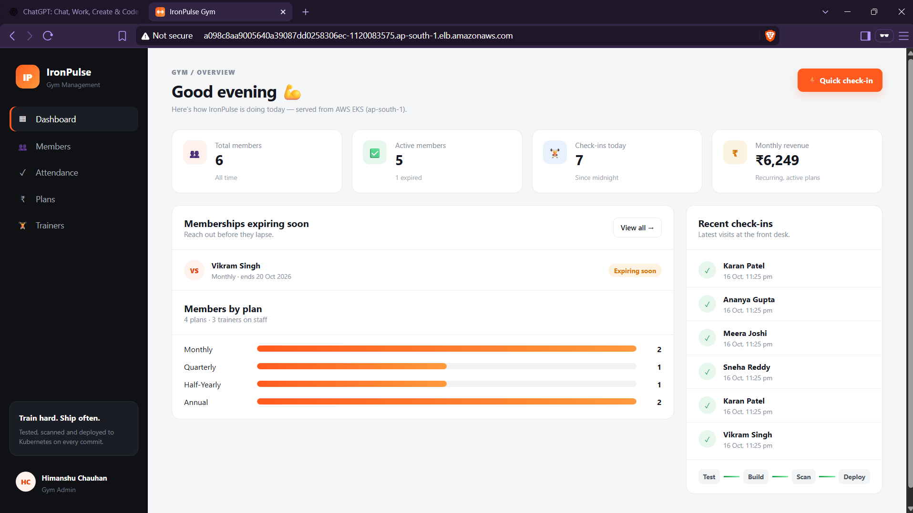
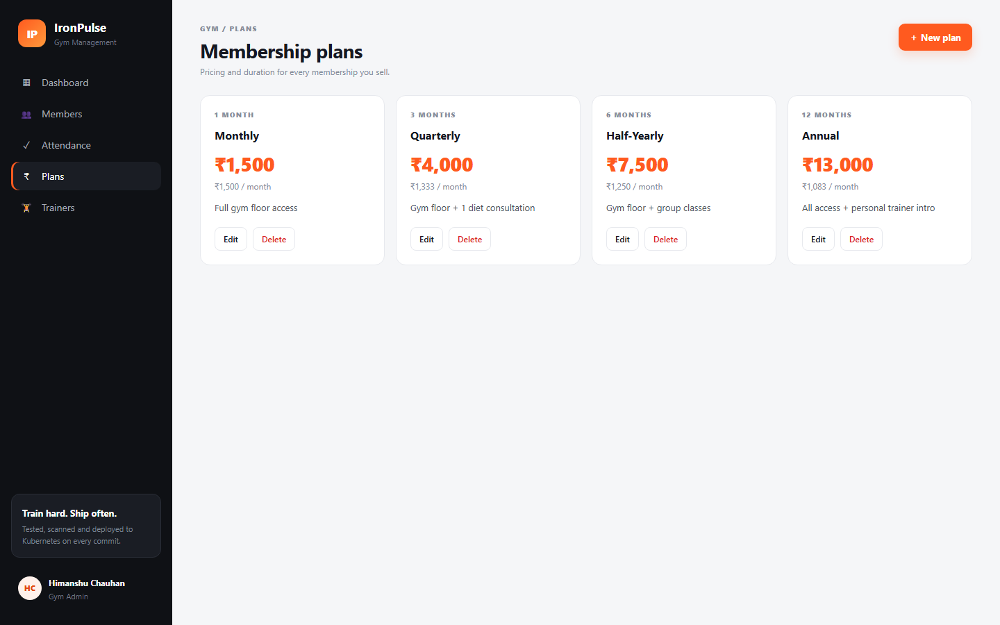
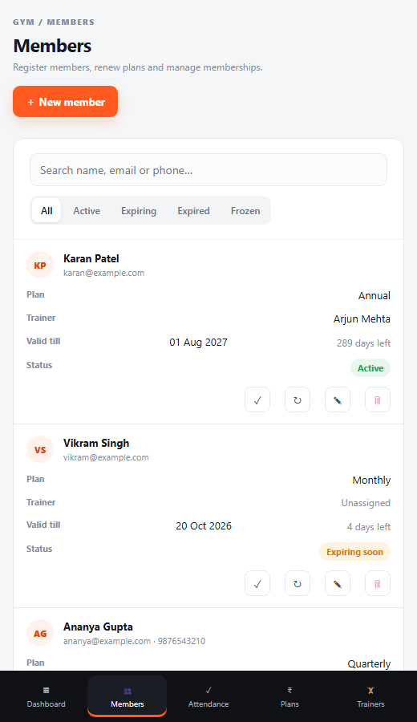
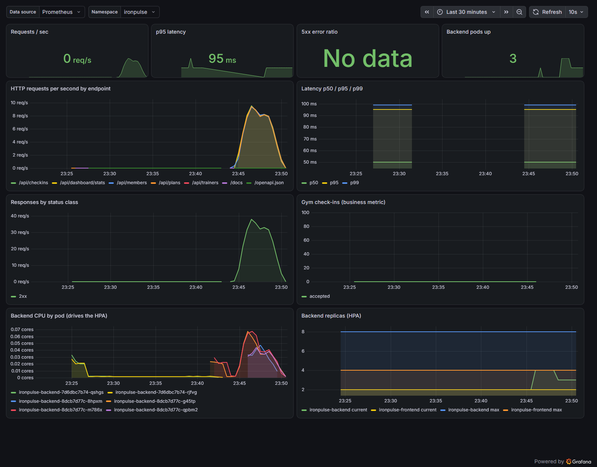

# IronPulse — Gym Management Platform (DevOps Capstone)


IronPulse is a gym management web app: front-desk staff register **members**, sell **membership plans**, assign **trainers** and record **attendance check-ins**. A dashboard shows active and expiring memberships, today's visits and monthly recurring revenue.

The application is the vehicle; the capstone is the delivery pipeline around it. Every push to `main` is tested, built into containers, scanned for vulnerabilities, published to GitHub Container Registry and deployed with Helm to an **AWS EKS** cluster provisioned by **Terraform**. There, Traefik routes traffic, the HPA scales the backend and Prometheus + Grafana monitor it.



**📊 Presentation:** the project slides are in [`docs/presentation/`](docs/presentation/). Open [IronPulse-Capstone.pdf](docs/presentation/IronPulse-Capstone.pdf) to view them in the browser, or download the [editable PowerPoint](docs/presentation/IronPulse-Capstone.pptx).

**🎬 Video walkthrough (≈3 min):** [watch on Google Drive](https://drive.google.com/file/d/10Hz3WGL_ThMl4qU7htD16tgQWGZg98OK/view?usp=sharing)

---

## Project status

The whole pipeline was run end-to-end on AWS (`ap-south-1`, Mumbai) on **16 Oct 2026** and then torn down with `terraform destroy`. Every claim below has a screenshot in [`docs/screenshots/`](docs/screenshots/); see the [Evidence](#evidence) section.

| Layer | Result |
|-------|--------|
| Application | ✅ React + FastAPI + PostgreSQL, 20+ REST endpoints, Alembic migrations |
| Tests | ✅ 27 pytest tests passing, isolated in-memory SQLite DB |
| Docker | ✅ Multi-stage, non-root images; `docker compose up --build` starts all 3 services |
| CI/CD | ✅ Green on `main`: test → build → Trivy → GHCR → **Helm deploy to EKS** |
| Security | ✅ Trivy: 0 fixable HIGH/CRITICAL in both images (after fixing 4 HIGH findings) |
| Terraform | ✅ `plan` (64 resources) → `apply` → VPC + EKS 1.35 + node group → `destroy` |
| Kubernetes + Helm | ✅ 2 backend + 2 frontend pods on EKS, ClusterIP Services, Traefik Ingress on an AWS load balancer |
| Autoscaling | ✅ HPA scaled the backend **2 → 4 pods** under load on EKS, then back down |
| Monitoring | ✅ Prometheus scraping 3/3 backend pods (UP), Grafana dashboard with live traffic |
| Troubleshooting | ✅ ImagePullBackOff, Service with no endpoints and CrashLoopBackOff, each reproduced and fixed on EKS |
| Teardown | ✅ `terraform destroy` complete, no AWS resources left running |

The cluster no longer exists, so the CI deploy job is switched off again (repository variable `DEPLOY_ENABLED=false`) and now shows as *skipped*. Everything else in the pipeline still runs on every push.

---

## Architecture

```text
Developer ──► GitHub ──► GitHub Actions
                           ├─ pytest (27 tests, isolated SQLite DB)
                           ├─ React production build
                           ├─ docker build (backend + frontend, tag = commit SHA)
                           ├─ Trivy scan (fail on fixable HIGH/CRITICAL)
                           ├─ push to ghcr.io (public)
                           └─ aws eks update-kubeconfig → helm upgrade --install --wait
                                                   │
Terraform ──► AWS VPC 10.30.0.0/16 (2 public + 2 private subnets, NAT gateway)
              └─► EKS 1.35 + managed node group (2 × m7i-flex.large, AL2023)
                                                   │
                     AWS load balancer ──► Traefik Ingress
                          ├─ /                   ──► frontend (React + Nginx)  ×2   HPA 2–4
                          └─ /api, /docs          ──► backend  (FastAPI)       ×2   HPA 2–8
                                                             │
                                                             ▼
                                            PostgreSQL StatefulSet + encrypted gp3 EBS volume
                     Prometheus ◄── ServiceMonitor (/metrics every 15 s) ── backend pods
                     Grafana    ◄── "IronPulse — API Overview" dashboard (auto-provisioned)
```

---

## Features

| Area | What it does |
|------|--------------|
| **Members** | Register, edit, search, filter by state (active / expiring soon / expired / frozen), renew, delete |
| **Plans** | Create and price plans (duration in months); a plan in use can't be deleted |
| **Trainers** | Manage coaching staff and see how many members each one trains |
| **Attendance** | One-click check-in; frozen, cancelled or expired members are refused |
| **Dashboard** | KPIs, memberships expiring in the next 7 days, members per plan, recent check-ins |

Membership end dates are computed from the plan duration (Jan 31 + 1 month = Feb 28). The "expired" and "expiring soon" states are derived from the end date rather than stored, so they are never stale. Four plans (Monthly, Quarterly, Half-Yearly, Annual) and three trainers are seeded by a migration.

| Membership plans | Members on mobile |
|---|---|
|  |  |

## Tech stack

| Layer | Tools |
|-------|-------|
| Frontend | React 19, Vite 8, plain CSS (responsive: sidebar → bottom tab bar on mobile) |
| Backend | Python 3.12, FastAPI, SQLAlchemy 2, Pydantic 2, Alembic migrations |
| Database | PostgreSQL 16 |
| Testing | Pytest + FastAPI TestClient on an in-memory SQLite database |
| Containers | Docker multi-stage builds, non-root users, Docker Compose |
| CI/CD | GitHub Actions → GHCR → Helm on EKS, image tag = Git commit SHA |
| Security | Trivy image scanning (action pinned by commit SHA), restricted Pod Security, least-privilege deploy user |
| Infrastructure | Terraform: AWS VPC + EKS + managed node group + EBS CSI driver + CI deployer IAM user |
| Kubernetes | Helm chart, Traefik Ingress, HPA, metrics-server |
| Observability | kube-prometheus-stack (Prometheus Operator + Grafana), ServiceMonitor, alert rules |

## Repository layout

```text
.
├── backend/                 FastAPI app
│   ├── app/                 models, schemas, business rules (services.py), routers/
│   ├── alembic/versions/    0001 schema, 0002 seed plans + trainers
│   ├── tests/               pytest suite (conftest.py = isolated test DB)
│   └── Dockerfile           multi-stage, non-root (uid 10001)
├── frontend/                React app
│   ├── src/pages/           Dashboard, Members, Attendance, Plans, Trainers
│   ├── nginx.conf.template  SPA + /api reverse proxy
│   └── Dockerfile           Node build stage → unprivileged Nginx (uid 101)
├── docker-compose.yml       postgres + backend + frontend
├── .github/workflows/       ci-cd.yml (test → build/scan/push → deploy)
├── terraform/               AWS VPC + EKS + deployer IAM user (+ terraform.tfvars.example)
├── k8s/                     namespace (restricted Pod Security), gp3 StorageClass (EKS)
├── helm/ironpulse/          chart: deployments, services, ingress, HPA, ServiceMonitor, Grafana dashboard
├── monitoring/              kube-prometheus-stack values, PrometheusRule alerts
├── scripts/                 bootstrap-cluster.sh, load-test.sh, seed-demo-data.sh
├── troubleshooting/         three deliberately broken manifests + lab guide
└── docs/                    presentation/ (slides), rubric evidence map, demo script, screenshots/
```

---

## API

Interactive docs: `http://localhost:8000/docs` with Docker Compose, `http://<ingress>/docs` on Kubernetes.

| Method | Path | Purpose |
|--------|------|---------|
| GET | `/health` | Liveness: process is up (no DB call) |
| GET | `/ready` | Readiness: DB reachable and schema migrated |
| GET | `/metrics` | Prometheus metrics (HTTP + `gym_checkins_total`) |
| GET / POST | `/api/plans` | List / create plans |
| GET / PUT / DELETE | `/api/plans/{id}` | Read / update / delete a plan (409 if in use) |
| GET / POST | `/api/trainers` | List (with member counts) / create trainers |
| GET / PUT / DELETE | `/api/trainers/{id}` | Read / update / delete (members get unassigned) |
| GET / POST | `/api/members` | List (`?state=`, `?q=` search) / register a member |
| GET / PUT / DELETE | `/api/members/{id}` | Read / update (status, plan, trainer…) / delete |
| POST | `/api/members/{id}/renew` | Extend by one plan period |
| GET / POST | `/api/checkins` | Visit log (`?member_id=`, `?limit=`) / check a member in |
| GET | `/api/dashboard/stats` | Dashboard KPIs and plan breakdown |

Example:

```bash
curl -X POST http://localhost:3000/api/members -H 'Content-Type: application/json' \
  -d '{"full_name":"Ananya Gupta","email":"ananya@example.com","plan_id":2,"trainer_id":1}'
curl -X POST http://localhost:3000/api/checkins -H 'Content-Type: application/json' -d '{"member_id":1}'
curl http://localhost:3000/api/dashboard/stats
```

---

## Run locally

**Prerequisites:** Docker Desktop. For the non-Docker path you also need Python 3.12+ and Node 22+.

### Option A: Docker Compose (whole stack, one command)

```bash
docker compose up --build
```

| URL | What |
|-----|------|
| http://localhost:3000 | IronPulse app |
| http://localhost:8000/docs | Swagger UI |
| http://localhost:8000/metrics | Prometheus metrics |

The backend runs `alembic upgrade head` on start, so the tables and seed data appear automatically. To add demo members and check-ins, run `URL=http://localhost:3000 ./scripts/seed-demo-data.sh`.
Stop with `docker compose down`; add `-v` to also delete the database volume.

### Option B: run the services directly

```bash
# Backend (needs a PostgreSQL; `docker compose up -d postgres` is the quickest)
cd backend
python -m venv .venv && source .venv/bin/activate      # Windows: .venv\Scripts\activate
pip install -r requirements-dev.txt
cp .env.example .env
alembic upgrade head
uvicorn app.main:app --reload --port 8000

# Frontend (separate terminal; Vite proxies /api to :8000)
cd frontend
npm ci
npm run dev                                            # http://localhost:5173
```

## Tests

```bash
cd backend
pytest -v
```

27 tests cover health, readiness and metrics; CRUD for plans, trainers and members; validation errors and duplicate detection; membership expiry, freezing and renewal; check-in rules; and dashboard statistics.

`tests/conftest.py` overrides FastAPI's `get_db` dependency with a fresh in-memory SQLite database for every test (foreign keys enabled), so tests never touch PostgreSQL. CI runs them before any image is built: if a test fails, nothing is pushed.

---

## CI/CD pipeline

[`.github/workflows/ci-cd.yml`](.github/workflows/ci-cd.yml) runs on every push and pull request to `main`:

| Job | Steps |
|-----|-------|
| **test** | `pip install -r requirements-dev.txt` → `pytest -v` → `npm ci` → `npm run build` |
| **build-scan-push** (needs test) | build both images tagged with `${{ github.sha }}` → Trivy scan each (fail on fixable HIGH/CRITICAL) → log in to GHCR → push (skipped for pull requests) |
| **deploy** (needs build, `main` only) | AWS credentials → `aws eks update-kubeconfig` → `helm upgrade --install --wait` with the new SHA → print pods/svc/ingress/hpa |

Using the commit SHA as the image tag gives traceability: any running pod can be traced to the exact commit that produced it, and `helm rollback` returns to a known image. A mutable `latest` tag can't do either.

On EKS, run [#4](https://github.com/Himanshu10071/devops-project/actions/runs/38945078958) built, scanned and deployed commit `e847841` to the cluster on its own: every pod was replaced with `…:e8478412292a…` images, and the dashboard subtitle change in that release appeared on the live load-balancer URL.

| Setting | Kind | Value |
|---------|------|-------|
| `DEPLOY_ENABLED` | Repository variable | `true` while a cluster exists (now `false`) |
| `AWS_REGION`, `EKS_CLUSTER_NAME` | Variables (optional) | default `ap-south-1`, `ironpulse-eks` |
| `AWS_ACCESS_KEY_ID`, `AWS_SECRET_ACCESS_KEY` | Secrets | keys of the Terraform-created `ironpulse-eks-ci-deployer` user |
| `POSTGRES_PASSWORD` | Secret (optional) | DB password; if unset, the chart keeps the password already in the cluster |

## Published images

Both images are **public** on GitHub Container Registry, so they can be pulled without logging in:

| Image | Package |
|-------|---------|
| `ghcr.io/himanshu10071/ironpulse-backend` | [ironpulse-backend](https://github.com/users/Himanshu10071/packages/container/package/ironpulse-backend) |
| `ghcr.io/himanshu10071/ironpulse-frontend` | [ironpulse-frontend](https://github.com/users/Himanshu10071/packages/container/package/ironpulse-frontend) |

Every successful pipeline pushes one tag per commit: the full 40-character Git SHA. There is no `latest` tag on purpose.

```bash
SHA=$(git rev-parse origin/main)          # or copy a tag from the package page
docker pull ghcr.io/himanshu10071/ironpulse-backend:$SHA
docker pull ghcr.io/himanshu10071/ironpulse-frontend:$SHA
```

## Security (DevSecOps)

- **Trivy** scans both images in CI and fails the build on any HIGH/CRITICAL vulnerability that has a fix available.
- **What it found:** the first scan of the backend reported 4 HIGH CVEs (urllib3 CVE-2026-97687 / CVE-2026-97689, msgpack GHSA-6v7p-g79w-8964, setuptools CVE-2025-47273). None were in the app's own dependencies; they were libraries bundled inside **pip**. pip is only needed at build time, so the Dockerfile now removes it from the runtime image. Both images then scanned clean (0 HIGH/CRITICAL) on Debian 13 and Alpine 3.24. A clean scan means no *known, fixable* HIGH/CRITICAL issues at scan time, not that the image is vulnerability-free.
- The Trivy action is pinned to a **full commit SHA** (v0.35.0). Its version tags were hijacked in a March 2026 supply-chain attack (CVE-2026-33634), so tags aren't trusted.
- **Least-privilege deploys:** GitHub Actions doesn't use an admin key. Terraform creates an `ironpulse-eks-ci-deployer` IAM user whose AWS permissions are only `eks:DescribeCluster` / `eks:ListClusters`; it gets cluster-admin *inside* Kubernetes through an EKS access entry. Its key was deleted together with the cluster.
- Containers run as **non-root** (backend uid 10001, Nginx uid 101, Postgres uid 70), with all Linux capabilities dropped, no privilege escalation and RuntimeDefault seccomp. The `ironpulse` namespace enforces the Kubernetes **restricted** Pod Security Standard.
- No secrets in Git: `.env`, `*.tfvars`, Terraform state and kubeconfigs are ignored, and CI reads credentials only from GitHub Secrets.

---

## Infrastructure: Terraform on AWS

[`terraform/`](terraform/) provisions everything in `ap-south-1` (Mumbai):

| Resource | Details |
|----------|---------|
| VPC | `10.30.0.0/16`; 2 public subnets (internet gateway, load balancer, NAT) + 2 private subnets (nodes, via NAT) across ap-south-1a/1b |
| EKS | Kubernetes 1.35, public API endpoint, API + ConfigMap authentication |
| Node group | managed, 2 × **m7i-flex.large** (2 vCPU / 8 GiB, AL2023), min 2 / max 3, in the private subnets |
| Add-ons | CoreDNS, kube-proxy, VPC CNI, EBS CSI driver (with an IRSA role) for the Postgres volume |
| CI deployer | IAM user + access key with `eks:DescribeCluster` only, plus a cluster-admin access entry |

Modules: `terraform-aws-modules/vpc` 5.21.0, `eks` 20.37.2, `iam` 5.60.0 (AWS provider v5).

```bash
cd terraform
cp terraform.tfvars.example terraform.tfvars   # no credentials in this file: use `aws configure`
terraform init
terraform plan                                  # Plan: 64 to add
terraform apply                                 # ~20 min
aws eks update-kubeconfig --region ap-south-1 --name ironpulse-eks
cd .. && ./scripts/bootstrap-cluster.sh          # gp3 StorageClass, Traefik (AWS LB), metrics-server, monitoring
```

**Teardown.** Delete what Kubernetes created in AWS first, then destroy:

```bash
helm uninstall ironpulse -n ironpulse && kubectl delete pvc --all -n ironpulse   # EBS volume
helm uninstall traefik -n traefik                                                # AWS load balancer
helm uninstall kube-prometheus-stack -n monitoring && helm uninstall metrics-server -n kube-system
cd terraform && terraform destroy
```

> **Cost:** while it exists, the stack costs roughly $0.30/hour (EKS control plane, NAT gateway, 2 nodes). It was destroyed straight after the evidence was captured.

## Kubernetes + Helm

```bash
helm upgrade --install ironpulse ./helm/ironpulse -n ironpulse -f helm/ironpulse/values-prod.yaml \
  --set backend.image.tag=<sha> --set frontend.image.tag=<sha>
kubectl get pods,svc,ingress,hpa -n ironpulse
helm list -n ironpulse
kubectl get svc -n traefik traefik     # load balancer hostname → open it in a browser
```

| Resource | Details |
|----------|---------|
| Deployments | backend ×2, frontend ×2, rolling updates with zero unavailable pods |
| StatefulSet | PostgreSQL with its own PersistentVolumeClaim (encrypted gp3 EBS on AWS) |
| Services | ClusterIP for backend (8000), frontend (80), postgres (5432) |
| Ingress | `/api`, `/docs`, `/openapi.json` → backend; `/` → frontend (Traefik) |
| HPA | backend 2–8 pods at 60% CPU (2–6 locally), frontend 2–4 at 70% |
| Probes | liveness `/health`, readiness `/ready`; an init container waits for the DB |
| Secret | DB credentials and `DATABASE_URL`; an empty password is rejected and an existing one is reused |
| ServiceMonitor + dashboard | rendered only when the Prometheus Operator CRDs exist |

Migrations run in each backend pod at start-up behind a PostgreSQL advisory lock, so replicas never race each other.

**Local cluster** (Docker Desktop Kubernetes, kind or minikube) works the same way:

```bash
./scripts/bootstrap-cluster.sh --local
helm upgrade --install ironpulse ./helm/ironpulse -n ironpulse -f helm/ironpulse/values-dev.yaml   # locally built images
# add "127.0.0.1 ironpulse.local" to your hosts file → http://ironpulse.local
```

### Autoscaling

```bash
kubectl get hpa -n ironpulse -w                                  # terminal 1
URL=http://<load-balancer-host> ./scripts/load-test.sh 240 40    # terminal 2
```

On EKS, backend CPU climbed to 99% of the 60% target and the HPA scaled from **2 to 4** replicas. When the load stopped it stepped down to 3 after the 2-minute stabilization window ([screenshot](docs/screenshots/m8-hpa-scaling.png)).

## Observability

- The backend exposes `/metrics` through `prometheus-fastapi-instrumentator`, which provides request counts, latency histograms and status codes per endpoint. It also exposes a business metric, `gym_checkins_total{result="accepted|rejected"}`.
- `kube-prometheus-stack` is installed by the bootstrap script with [`monitoring/prometheus-values.yaml`](monitoring/prometheus-values.yaml). The chart's **ServiceMonitor** makes Prometheus scrape every backend pod every 15 s; on EKS all three backend pods showed **UP**.
- The **IronPulse — API Overview** Grafana dashboard ships in the chart as a ConfigMap and is loaded automatically. Panels: requests/s, p50/p95/p99 latency, 5xx ratio, responses by status, check-ins, backend CPU per pod and HPA replicas.
- [`monitoring/alert-rules.yaml`](monitoring/alert-rules.yaml) defines alerts for backend down, more than 5% errors and p95 latency over 1 s.

```bash
kubectl port-forward -n monitoring svc/kube-prometheus-stack-prometheus 9090:9090   # http://localhost:9090 → Status → Targets
kubectl port-forward -n monitoring svc/kube-prometheus-stack-grafana 3001:80        # http://localhost:3001  (admin / ironpulse-admin)
```



## Troubleshooting lab

[`troubleshooting/`](troubleshooting/README.md) contains three broken manifests. All three were reproduced and fixed on EKS ([screenshot](docs/screenshots/m8-troubleshooting.png)):

| Lab | Symptom | Root cause |
|-----|---------|------------|
| `broken-image.yaml` | `ImagePullBackOff` | image tag does not exist |
| `broken-service.yaml` | Service has no endpoints | selector labels match no pods; wrong `targetPort` |
| `broken-db-config.yaml` | `CrashLoopBackOff` | `DATABASE_URL` points at a non-existent host |

---

## What went wrong on the way (and the fixes)

Real incidents from the AWS run, each fixed in the code:

| Incident | Diagnosis | Fix |
|----------|-----------|-----|
| No worker nodes after 13 min | Auto Scaling activity: *"instance type is not eligible for Free Tier"*. The AWS account is on the Free plan. | Node type changed from t3.medium to **m7i-flex.large** (Free Tier eligible) |
| `kubectl` would be locked out | EKS doesn't accept the AWS root user as an access-entry principal | Terraform creates a dedicated **deployer IAM user** with a cluster-admin access entry |
| First CI deploy: new backend pods crash-looped (`fe_sendauth: no password supplied`) | The deploy step passed an empty `POSTGRES_PASSWORD` secret to Helm | **`helm rollback`** to the last good revision (no downtime: old pods kept serving). Then the workflow only passes the password if set, and the chart reuses the in-cluster password ([screenshot](docs/screenshots/m8-helm-rollback.png)) |
| Lab pod never appeared | The namespace's *restricted* Pod Security level rejected the lab pod at admission | Lab manifests now carry a compliant securityContext |
| Service "fix" still had no endpoints | A merge patch *adds* selector keys, so the wrong `app` key stayed | Patch with `"app": null` (documented in the lab guide) |
| Intermittent `no such host` from Terraform | Flaky local DNS, not AWS | Re-ran `apply`/`destroy` (idempotent); requests never reached AWS |

---

## Evidence

All screenshots are in [`docs/screenshots/`](docs/screenshots/). Terminal captures are rendered from the real command output.

| Module | Screenshots |
|--------|-------------|
| M1 App | `m8-browser-ingress-elb.png`, `app-dashboard.png`, `app-plans.png`, `app-members-mobile.png`, `m8-app-eks-swagger.png` |
| M2 Tests | `m2-pytest.png` |
| M3 Git | `m3-github-commits.png`, `m3-git-log.png` |
| M4 Docker | `m4-compose-up.png`, `m4-compose-ps-nonroot.png` |
| M5 CI/CD | `m5-actions-run-deploy.png`, `m5-ghcr-backend.png`, `m5-ghcr-frontend.png` |
| M6 Trivy | `m6-trivy-backend.png`, `m6-trivy-frontend.png` |
| M7 Terraform | `m7-terraform-plan.png`, `m7-console-vpc.png`, `m7-console-subnets.png`, `m7-console-eks-cluster.png`, `m7-console-eks-nodegroup.png`, `m7-aws-vpc-cli.png`, `m7-aws-eks-cli.png`, `m7-terraform-destroy.png`, `m7-aws-after-destroy.png` |
| M8 K8s + Helm | `m8-kubectl-pods.png`, `m8-kubectl-svc-ingress-hpa.png`, `m8-helm-list-history.png`, `m8-helm-rollback.png`, `m8-hpa-scaling.png`, `m8-troubleshooting.png` |
| M9 Monitoring | `m9-metrics.png`, `m9-prometheus-targets.png`, `m9-grafana-dashboard.png` |

[`docs/SUBMISSION.md`](docs/SUBMISSION.md) maps each rubric criterion to its files, commands and screenshots. [`docs/DEMO.md`](docs/DEMO.md) is the presentation script.

**Author:** Himanshu Chauhan · [github.com/Himanshu10071](https://github.com/Himanshu10071)
